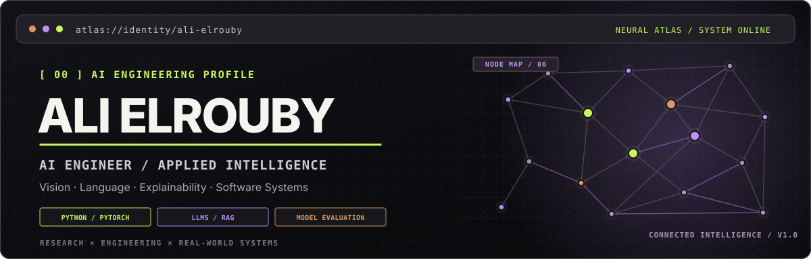
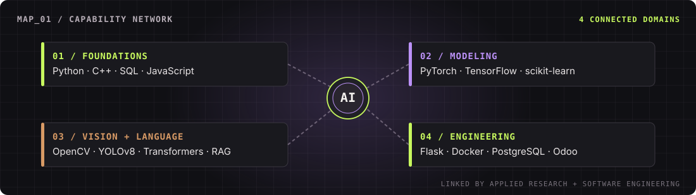
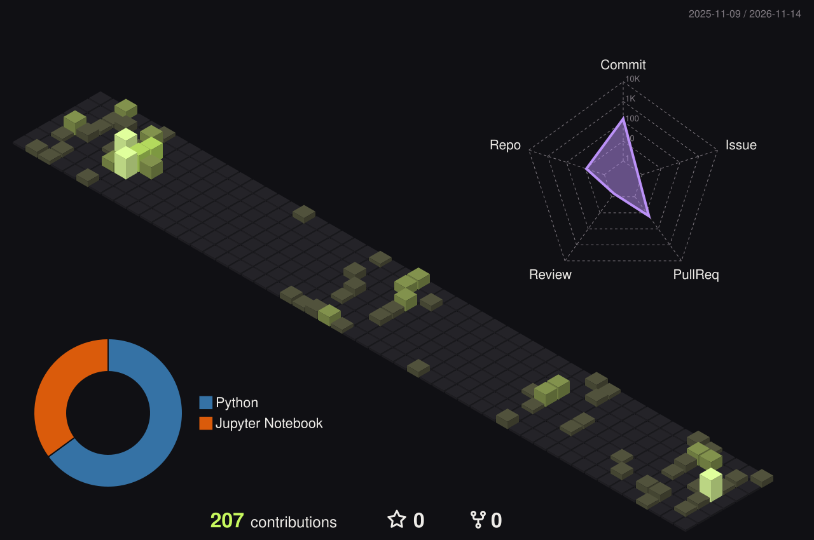
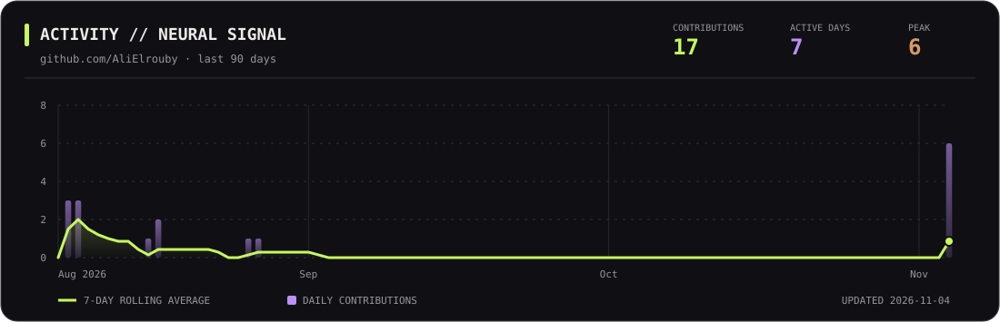
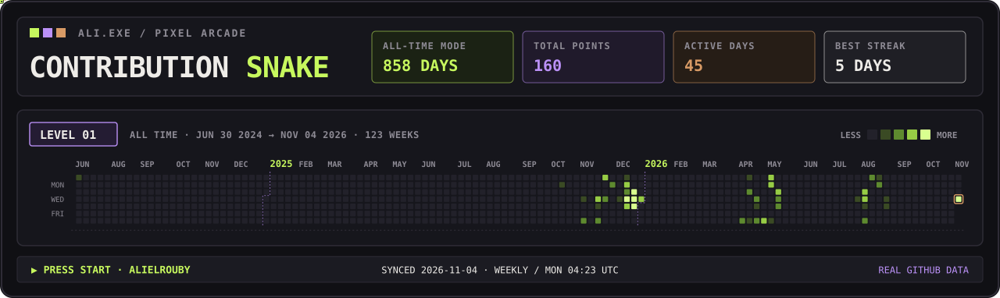
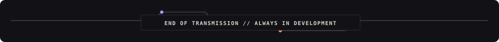

<!--
  ALI ELROUBY // NEURAL ATLAS
  Theme: Obsidian #101014 · Acid Lime #C7F85E · Violet #BB91F7 · Copper #D89A65
  The 3D city and snake appear after the workflows are run for the first time.
-->

  

  

  
  
  

 

## ABOUT ME

<table>
<tr><td width="100%" valign="top">

### Ali Elrouby 

**Data Science & Artificial Intelligence** undergraduate at **Zewail City of Science and Technology** · **B.S. expected 2027**.

I build at the intersection of **machine learning, applied research, and software engineering** — from computer vision and NLP to explainable AI, cybersecurity analytics, and software-integrated intelligent systems.

</td></tr>
</table>

<table>
<tr>
<td width="50%" valign="top">

**CURRENT ROLE**

### AI Engineer Intern
**BUCHI Services Egypt**

Agentic AI · LLMs / SLMs · RAG · MCP · Multimodal Systems

</td>
<td width="50%" valign="top">

**ENGINEERING FOCUS**

### Research → Real Systems
**ML / DL · Evaluation · Backend Engineering**

*Understand the model. Engineer the system. Measure the result.*

</td>
</tr>
</table>

<b>Explore my experience & background</b>

 

- **BUCHI Services Egypt — AI Engineer Intern (Oct 2026–present):** Working with agentic AI, LLMs/SLMs, MCP, RAG, fine-tuning, knowledge distillation, self-supervised learning, and multimodal architectures.
- **Sowaidan Group — Odoo ERP Developer Intern (Jul–Aug 2026):** Developed ERP models, views, business logic, and custom modules with Python, XML, and PostgreSQL.
- **Beyond class:** Vice-Head of Computer Science at the IEEE Student Branch; ECPC programming-contest participant.

---

## TECHNOLOGY STACK

  

<table>
<tr>
<td valign="top" width="50%">

**LANGUAGES**

   

</td>
<td valign="top" width="50%">

**AI & DEEP LEARNING**

   

</td>
</tr>
<tr>
<td valign="top" width="50%">

**VISION & LANGUAGE**

     

</td>
<td valign="top" width="50%">

**SOFTWARE & TOOLS**

      

</td>
</tr>
</table>

---

## FEATURED WORK

<!-- Project repositories have intentionally not been linked where a public URL has not been verified. -->

| File | Project / stack | Highlights |
|:--|:--|:--|
| `CV_001` | **RC-Car Bowling Detection**  `YOLOv8n` · `OpenCV` · `Roboflow` | Real-time car and bowling-pin detection with temporal tracking; trained on ~1,050 labeled images. |
| `NLP_002` | **Medical Symptom-to-Disease Classification**  `PyTorch` · `BiLSTM` · `FastText` · `DistilBERT` | 24-class text classification; **95.32% test accuracy** and **95.53% macro F1**. |
| `XAI_003` | **Explainable Multimodal Diabetic Retinopathy Classification**  `TensorFlow/Keras` · `GAT` · `SHAP` · `Grad-CAM` | Retinal images + clinical features; **87.80% test accuracy**, **63.02% balanced accuracy**, and **55.26% macro F1** on 754 held-out patients. |
| `SEC_004` | **Cybersecurity Anomaly Detection**  `scikit-learn` · `LightGBM` · `Random Forest` | ML detection pipelines with engineered features; **91.5% multiclass accuracy** and **1st place** in a course competition. |

---

## 3D CONTRIBUTION CITY · LAST 12 MONTHS

  
  3D activity terrain · lime + violet + graphite · generated daily from GitHub contributions

<!-- The image above appears after the 'Update 3D contribution city' workflow first succeeds. -->

---

## GITHUB ACTIVITY

  
  

  
  Real GitHub contributions over the last 90 days · rendered daily by this repository’s GitHub Action

---

## RETRO ARCADE · 2-YEAR CONTRIBUTION SNAKE

  
  Last two years of GitHub contributions · retro arcade pixel snake · refreshed every Monday

---

  <a href="mailto:alielrouby78@gmail.com"><b>CONNECT / COLLABORATE</b></a>
  &nbsp;·&nbsp;
  <a href="https://www.linkedin.com/in/ali-elrouby-3493302b5/">LinkedIn</a>
  &nbsp;·&nbsp;
  <a href="https://github.com/AliElrouby?tab=repositories">Repositories</a>

    
  

